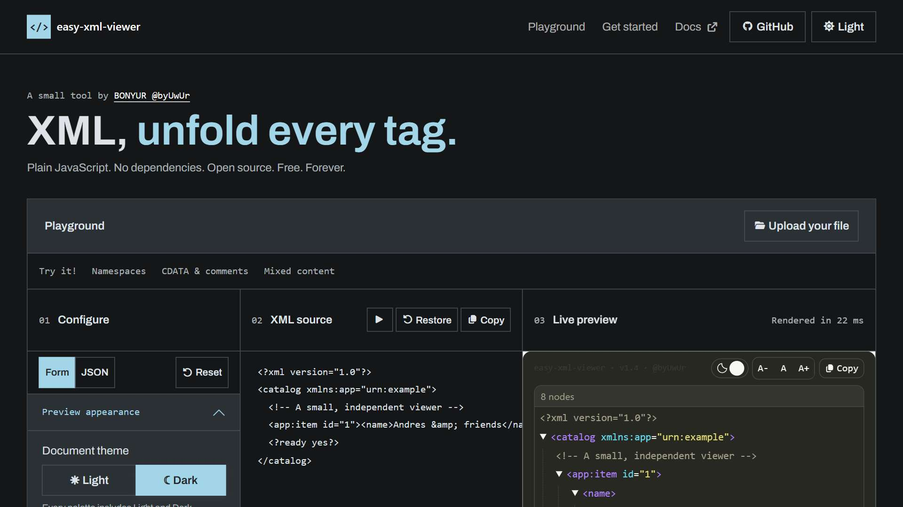

# XML.view

Explore elements, attributes, namespaces, text, comments, and CDATA in a searchable tree.



## Index

1. [Quick start](#quick-start)
2. [Try it](#try-it)
3. [Downloads](#downloads)
4. [API and options](#api-and-options)
5. [Themes](#themes)
6. [Checks and releases](#checks-and-releases)
7. [Related projects](#related-projects)
8. [License](#license)

## Quick start

```html
<link href="https://cdn.jsdelivr.net/gh/byuwur/xml.view@latest/xml.min.css" rel="stylesheet" />
<script src="https://cdn.jsdelivr.net/gh/byuwur/xml.view@latest/xml.min.js" defer></script>
<div id="viewer" data-theme="light"></div>
<script>
  document.addEventListener("DOMContentLoaded", () => {
    byXMLviewer(document.getElementById("viewer"), '<root><item id="1">Hello</item></root>', { collapsed: true });
  });
</script>
```

Pin a published tag in place of `@latest` for a fixed version.

### Offline use and Content Security Policy

The renderer loads no remote scripts, fonts, or styles. Local library files work without a CDN, including in a `file://` host. Host optional `xml.themes.css` locally for extra palettes. The online playground and exported CDN starter still require internet access; a local starter requires all referenced files beside it. Playground fetches and clipboard permissions remain subject to browser restrictions.

Allow the script and style origins in your CSP. Authorize inline initialization and custom theme CSS separately, or move them into local files. The controls use static HTML templates and do not support enforced Trusted Types.

## Try it

[Playground](https://xml.byuwur.co/)

The library contains no tracking. The [privacy policy](https://byuwur.co/privacy/dotview) and [cookie policy](https://byuwur.co/cookies/dotview) apply only to the hosted landing page and playground.

Open [index.html](index.html) locally. Its host assets use the network. Exported starters use the default settings. The playground accepts local files up to 6 MiB.

## Downloads

[ZIP](https://github.com/byuwur/xml.view/releases/latest/download/xml.view.zip) · [Minified ZIP](https://github.com/byuwur/xml.view/releases/latest/download/xml.view.minified.zip)

## API and options

1. [Input and API](#input-and-api)
2. [XML options and limits](#xml-options-and-limits)
3. [Shared controls and lifecycle](#shared-controls-and-lifecycle)

### Input and API

`byXMLviewer(element, xml?, options?)` accepts a string; omitted input uses the target's text. Empty/whitespace-only input displays an empty state. Malformed or oversized input displays an error and resolves `ready` false.

`byXMLviewer.parse(xml)` uses the browser's XML parser and returns a detached XMLDocument, or null for empty input. It shares the renderer's parser and limits. Invalid input throws `TypeError`, `SyntaxError`, or `RangeError`.

Names retain namespace prefixes and declarations. Attribute values and character references are decoded. Node copy includes descendants and uses XMLSerializer, so quotes, entities, and empty-element formatting may differ from the source. Main Copy preserves the original source.

Copy value uses an element's textContent or a leaf's nodeValue. The XML declaration is displayed separately and excluded from node-search counts.

DTDs/DOCTYPE declarations, including internal/external entities, are rejected. Standard XML entities and numeric references are supported; declaration-like text in comments/CDATA stays ordinary data. Nodes are never imported into the page, and scripts, styles, or external resources are not activated.

Parse-error messages vary by browser. Elements named `parsererror` in the XHTML or Mozilla parser-error namespaces are reserved for error detection; use another namespace for user data with that name.

### XML options and limits

| Option           | Default | Behavior                                                                                                                                                                                       |
| ---------------- | ------- | ---------------------------------------------------------------------------------------------------------------------------------------------------------------------------------------------- |
| `collapsible`    | `true`  | Show disclosure controls; false keeps every node expanded.                                                                                                                                     |
| `collapsed`      | `false` | Initially close element disclosures.                                                                                                                                                           |
| `showWhitespace` | `false` | Include whitespace-only text nodes. Significant text spacing is always retained.                                                                                                               |
| `search`         | `false` | Case-insensitive substring search over node names, attribute names/values, and leaf values. Show matching nodes and their ancestor paths, expanded. Clearing restores initial collapse policy. |
| `copyNodes`      | `false` | Show node copy buttons, including collapsed descendants.                                                                                                                                       |

Expand/collapse affects displayed elements only. Filtering leaves source XML unchanged. Mixed text and elements keep document order; indentation is for navigation.

Limits: 2 million input characters, 50,000 document nodes (including whitespace), and 256 nesting levels. DOMParser and indexing are synchronous; DOM creation yields every 100 visible nodes and search every 1,000 records. Closed branches remain in the DOM, so large documents can consume substantial memory. Re-rendering or a new search cancels obsolete DOM work.

### Shared controls and lifecycle

| Option             | Default     | Behavior                                                                                                                                                   |
| ------------------ | ----------- | ---------------------------------------------------------------------------------------------------------------------------------------------------------- |
| `animations`       | `true`      | Brief control/disclosure motion and background fades; overrides the system motion preference.                                                              |
| `appearAnimation`  | `false`     | Fade the viewer in on each render when `animations` is enabled. Initial rendering remains immediate by default.                                            |
| `toolbar`          | `true`      | Show the viewer header; secondary tools are configured separately.                                                                                         |
| `credits`          | `true`      | Show attribution in the header.                                                                                                                            |
| `displayContainer` | `true`      | Show the content panel frame and inner horizontal padding. `false` also hides status information.                                                          |
| `statusBar`        | `true`      | Show counts and metadata when `displayContainer` is true. With `statusBar: false`, loading and empty results remain visible; errors always remain visible. |
| `expandCollapse`   | `false`     | Show Expand all / Collapse all.                                                                                                                            |
| `copyValues`       | `false`     | Show copy-value buttons, independently of copyNodes.                                                                                                       |
| `theme`            | Container   | Initial `"light"` or `"dark"` mode class.                                                                                                                  |
| `palette`          | Container   | Initial `data-theme` palette, including custom CSS names.                                                                                                  |
| `fontSize`         | Container   | Number in rem or a CSS size such as `"1.25em"` or `"20px"`; bounded to `0.5rem`-`3rem`.                                                                    |
| `themeToggle`      | `true`      | Show the theme toggle.                                                                                                                                     |
| `fontSizeControls` | `true`      | Show text-size controls.                                                                                                                                   |
| `copyButton`       | `true`      | Show full source copy button.                                                                                                                              |
| `controlsSize`     | `"regular"` | `"xs"` (0.5rem), `"small"` (0.7rem), `"regular"` (0.875rem), `"large"` (1rem), or `"xl"` (1.25rem); invalid values use `"regular"`.                        |
| `controlsCompact`  | `true`      | Keep credits beside controls; `false` stacks them. Wraps as needed.                                                                                        |
| `controlsPosition` | `"top"`     | Sticky `"top"` or `"bottom"` toolbar; invalid values use `"top"`.                                                                                          |

The controller exposes `ready` and `destroy()`. `ready` resolves `true` after initial rendering, or `false` on a displayed data error or cancellation. Invalid targets/options can throw synchronously.

`ready` describes the initial render only; it does not track later searches or disclosure changes.

```javascript
const viewer = byXMLviewer(target, xml, { search: true });
const rendered = await viewer.ready; // false on data errors or cancellation.
viewer.destroy(); // Call when the host panel is removed.
```

Re-rendering disposes the previous instance. `destroy()` cancels pending work and clears the target only if the instance still owns it. Duplicate script loads preserve the API. Read its version with `byXMLviewer.VERSION`.

Input is displayed as text, never executed. Style `.byXMLdocument` with `--by-view-bg`, `--by-view-text`, `--by-view-muted`, `--by-view-border`, `--by-view-accent`, `--by-view-alt`, `--by-view-string`, and `--by-view-literal`. The container uses system-ui; source/tree content uses monospace. Override the class or target's inline font/size as needed.

Copy requires clipboard permission in a secure context.

Requires a modern browser with async functions, WeakMap, ES2022 array methods, and CSS variables. The browser suites can run in Chromium, Firefox, and WebKit (see Checks).

`--by-view-content-font` and `--by-view-line-height` set source/tree typography.

The playground disables header-only settings while Viewer header is off, preserving their values. Appearing animation is disabled while Animations is off.

Use `toolbar: false` to hide the header, or disable `credits`, `themeToggle`, `fontSizeControls`, and `copyButton` individually. Content actions such as search and format-specific buttons use their own options.

Controls use monospace by default; override `--by-view-controls-font` to change it.

## Themes

Use `theme` for light or dark mode and `palette` for the color scheme. Monokai, GitHub, Solarized and High Contrast are built in. Load [xml.themes.css](xml.themes.css) after the base stylesheet for the other palettes.

Options override container settings. Omit an option or pass `null` to keep its current value. Numeric `fontSize` uses rem. CSS sizes such as `20px` also work within the `0.5rem` to `3rem` range. Invalid appearance values throw `RangeError` before replacing the document.

```html
<div id="viewer" class="dark" data-theme="github"></div>
```

Use **Copy CSS** in the playground to export appearance settings. Set `--by-view-document-bg` for the outer background and `--by-view-container-bg` for panels and controls. Define custom palette variables on the component’s mode class and `[data-theme]` selector. For example:

```css
.byXMLdocument.dark[data-theme="my-ocean"] {
  --by-view-bg: #102a43;
  --by-view-text: #f0f6fc;
}
```

### Palette names

`monokai`, `github`, `solarized`, `high-contrast`, `dracula`, `darcula`, `nord`, `catppuccin`, `catppuccin-frappe`, `catppuccin-macchiato`, `rose-pine`, `rose-pine-moon`, `gruvbox`, `gruvbox-material`, `tokyo-night`, `tokyo-storm`, `tokyo-moon`, `one`, `material`, `material-ocean`, `night-owl`, `synthwave`, `ayu`, `everforest`, `kanagawa`, `selenized`, `vscode`, `monokai-dimmed`, `discord`, `slack`, `bonyur`, `sakura`, `bubblegum`, `candy`, `rose-gold`, `lavender`, `cyberpunk`, `sunset`, `volcano`, `amber`, `terminal`, `paper`, `ink`, `ocean`, `forest`, `mint`, `ice`, `sepia`.

High Contrast text colors target at least [7:1 contrast](https://www.w3.org/WAI/WCAG22/Understanding/contrast-enhanced.html), with [3:1 contrast for control boundaries and focus cues](https://www.w3.org/WAI/WCAG22/Understanding/non-text-contrast.html). Check contrast again when you override colors.

Legacy integrations can use `#byVIEWtheme` or a detected `xml.light.css` / `xml.dark.css` link. The toggle keeps its path, query, and hash and updates viewers sharing the link. Explicit container themes stay independent. Separate theme files are no longer shipped; retain your hosted legacy files to use this alternative.

## Checks and releases

Use Node.js 22+ and run these commands from the repository root. For playground checks, place sibling checkouts of `spa.js` at `v20.16`, `code.view` at `v2` next to this repository.

```sh
npm --prefix .github ci --ignore-scripts --no-audit --no-fund
node .github/node_modules/playwright/cli.js install chromium
export NODE_PATH="$PWD/.github/node_modules"
node --test --test-concurrency=1 __tests__/rendering.cjs __tests__/playground.cjs
node .github/scripts/build.mjs --tag v0.0.0-local
npm --prefix .github run release:test
```

In PowerShell, replace the `export` line with `$env:NODE_PATH = "$PWD/.github/node_modules"`. [CI](.github/workflows/rendering.yml) runs Chromium, Firefox and WebKit by default. Manual runs can target one browser.

The [release workflow](.github/workflows/release.yml) tests the regular and minified ZIPs. Both contain the runtime files, README and license. The build manifest records the version and source commit. The local build writes `dist/assets/` and `dist/RELEASE_NOTES.md`. Use `--offline` for local minification. Publish by pushing a version tag matching the library’s `VERSION` (for example, `v2` for version 2).

## Related projects

[CODE.view](https://github.com/byuwur/code.view) · [CSV.view](https://github.com/byuwur/csv.view) · [DIFF.view](https://github.com/byuwur/diff.view) · [JSON.view](https://github.com/byuwur/json.view) · [LOG.view](https://github.com/byuwur/log.view) · [MD.edit](https://github.com/byuwur/md.edit) · [MD.view](https://github.com/byuwur/md.view) · [YAML.view](https://github.com/byuwur/yaml.view)

## License

MIT (c) 2026 Andres Trujillo [Mateus] byUwUr. See [LICENSE](LICENSE.md).
